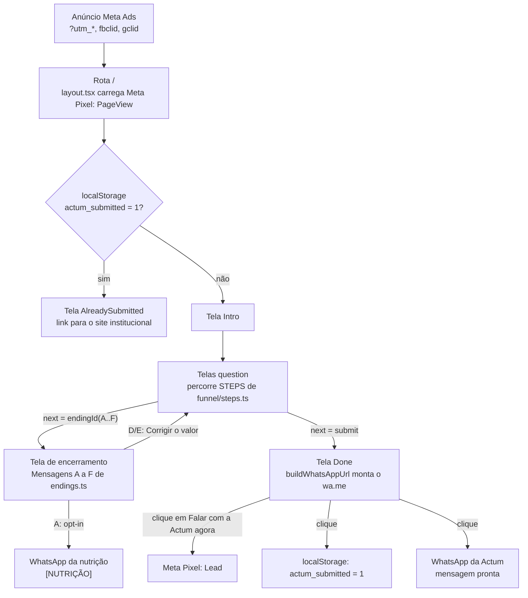

# Formulário Actum: arquitetura

Atualizado em 20/10/2026

## Visão geral

O form-actum é uma landing page com um funil de qualificação para a **Actum Precatórios**. O visitante responde perguntas curtas e, no final, abre o WhatsApp da Actum com uma mensagem já escrita, que contém as respostas e a origem da campanha (UTMs).

- **Stack:** Next.js 16 (App Router), React 19, TypeScript, Tailwind 4, Vitest.
- **Build:** exportação estática (`output: "export"` em `next.config.ts`). O resultado é a pasta `out/`, com HTML, CSS e JS puros. Não há servidor Node em produção.
- **Sem backend e sem banco.** O lead não é gravado em lugar nenhum pelo site. A entrega é o próprio lead enviando a mensagem no WhatsApp.
- **Uma rota só:** `/`, que renderiza o componente `Funnel`.

Diferente do `form-main` (BMZ), aqui não há linktree, rodízio de números, webhook para BI nem TikTok Pixel. A estrutura é a do `form-main` reduzida a um único funil.

## Fluxo



Quem cai numa tela de encerramento não vai para a fila comercial. A Mensagem A oferece a lista de nutrição. As Mensagens D e E deixam corrigir o valor. As outras são definitivas.

O clique final faz três coisas juntas: dispara o `Lead`, marca o navegador como "já enviou" e abre o WhatsApp. A conversão só se completa quando o lead aperta "enviar" no app.

## Estrutura de pastas

```
src/
  app/
    layout.tsx            fonte Poppins, metadata (noindex), Meta Pixel
    page.tsx              única rota: renderiza <Funnel />
    globals.css           tema Tailwind (gold, ink, paper, slate, sage)
  components/
    Funnel.tsx            motor do funil + telas Intro, EndingScreen, Done, AlreadySubmitted
    Funnel.test.tsx       fluxos completos em jsdom (encerramentos, correção, envio)
  lib/
    config.ts             constantes: WhatsApp (comercial e nutrição), site, pixel,
                          salário mínimo / teto da RPV / valor mínimo, tracking
    funnel/               o questionário
      types.ts            formato de um step e de uma tela de encerramento
      steps.ts            STEPS, FIRST_STEP, BRANCH_STEPS, LEAD_NOTES: perguntas e regras
      endings.ts          ENDINGS (Mensagens A a F), endingId, endingOf
      navigation.ts       motor puro: stepById, resolveNext, labelFor, questionOf, pathTotal
      validation.ts       validateStep: erro de cada tipo de campo
    format/
      currency.ts         formatReais: 97260 -> "R$ 97.260"
    input/                o que o lead digita
      name.ts             maskName, isValidName
      phone.ts            maskPhone, isValidPhone
    tracking/             medição de campanha
      utm.ts              readTracking: UTMs, referrer, landing page
      pixel.ts            trackPixelEvent, wrapper do fbq
    whatsapp/             entrega do lead
      message.ts          buildMessage/buildWhatsAppUrl (lead), buildNurtureUrl (nutrição)
    submission/           estado entre visitas
      status.ts           flag "já enviou" no localStorage
public/
  logo-actum.png
docs/
  arquitetura.md          este arquivo
  meta-pixel.md           como trocar ou incluir o pixel
  perguntas.md            cada pergunta do funil e o motivo dela
```

## Camadas e responsabilidades

| Arquivo | Responsabilidade | O que você edita nele |
| --- | --- | --- |
| `lib/config.ts` | Constantes de negócio e integração | Números do WhatsApp, URL do site, ID do pixel, **salário mínimo (todo janeiro)**, valor mínimo, UTMs |
| `lib/funnel/steps.ts` | Fonte de verdade do funil: perguntas, opções, ordem, ramificação, rótulo de cada resposta na mensagem, sub-perguntas condicionais, etiquetas da mensagem | Texto de pergunta, opção nova, regra de encerramento |
| `lib/funnel/endings.ts` | Telas de encerramento (Mensagens A a F): título, texto, se oferece nutrição, se deixa corrigir | Texto de uma mensagem, nova tela de encerramento |
| `lib/funnel/types.ts` | Formato de um step e de um encerramento | Só ao criar um tipo novo de pergunta |
| `lib/funnel/navigation.ts` | Funções puras que percorrem `STEPS`. Sem regra de negócio. | Quase nunca |
| `lib/funnel/validation.ts` | Mensagem de erro de cada tipo de campo | Texto ou regra de validação |
| `lib/input/*.ts` | Máscara e validação de cada campo digitado | Regra de nome ou telefone |
| `lib/tracking/*.ts` | Captura de UTMs (`utm.ts`) e eventos do pixel (`pixel.ts`) | Novo parâmetro vai em `config.ts`. Nova plataforma de anúncio entra aqui. |
| `lib/whatsapp/message.ts` | Headline, corpo, observações e link `wa.me` do lead. Mensagem e link da nutrição. | Formato das mensagens |
| `lib/submission/status.ts` | Flag "já enviou" e hook `useHasSubmitted` | Regra de reabrir o funil |
| `components/Funnel.tsx` | Máquina de telas, histórico e botão Voltar, barra de progresso, atalhos de teclado, textos das telas fixas | Textos de Intro, Final e Já enviado |
| `app/layout.tsx` | Casca HTML, fonte, SEO e pixel | Título, descrição, código do pixel |

A regra é: `funnel/steps.ts` descreve, `funnel/navigation.ts` e `Funnel.tsx` executam. Mudar uma pergunta, incluir uma opção, mudar quem é encerrado ou mudar o que vai na mensagem se resolve em `steps.ts` e `config.ts`, sem tocar no componente.

### Dependências entre as pastas

| Módulo | Importa |
| --- | --- |
| `funnel/types` | nada |
| `funnel/endings` | `config`, `format/currency`, `funnel/types` |
| `funnel/steps` | `config`, `format/currency`, `funnel/endings`, `funnel/types` |
| `funnel/navigation` | `funnel/steps`, `funnel/types` |
| `funnel/validation` | `input/*`, `funnel/navigation` |
| `tracking/utm` | `config` |
| `whatsapp/message` | `config`, `funnel/*`, tipo `Tracking` de `tracking/utm` |
| `input/*`, `format/*`, `tracking/pixel`, `submission/status` | nada do projeto |

`funnel/` não conhece WhatsApp nem tracking, então dá para trocar o canal de entrega sem mexer nas perguntas. `input/`, `pixel.ts` e `submission/` não dependem de nada do projeto e podem ser copiados para outro formulário como estão. Os imports usam o caminho completo do arquivo (`@/lib/funnel/steps`), sem `index.ts`, para o import já dizer de onde vem cada coisa.

## O formato de um step

```ts
type Step = {
  id: string;
  summaryLabel: string;      // rótulo na mensagem do WhatsApp
  question: string | ((answers) => string);
  helper?: string;           // texto de ajuda abaixo da pergunta
  hideInSummary?: boolean;   // true = não vira linha na mensagem
} & (
  | { kind: "text" | "phone" | "name"; placeholder; optional?; next: string }
  | { kind: "choice"; options: Choice[]; layout?: "grid"; next: string | ((value) => string) }
  | { kind: "select"; options: Choice[]; placeholder; next: string }   // <select> nativo
  | { kind: "consent"; options: Choice[]; next: string }                // checkboxes obrigatórios
);
```

- **`next` como texto** leva sempre ao mesmo step. **`next` como função** recebe a resposta e decide o próximo id. Toda a lógica condicional mora aí.
- **Encerrar o funil:** o `next` devolve `endingId("A")` (ou B a F). O motor mostra a tela correspondente de `endings.ts`. Ids que começam com `end:` são reservados para isso.
- **`"submit"` é reservado.** Encerra o funil e monta o WhatsApp do lead.
- **`kind`** define o input: `choice` (botões), `text` (livre), `name` (só letras, mínimo 2), `phone` (máscara `(00) 00000-0000`, 10 ou 11 dígitos), `select` (lista nativa, usada nos 27 estados) e `consent` (checkboxes; todos precisam estar marcados). No `consent`, a resposta guarda os valores marcados separados por vírgula.
- **`optional`** vale para `text`. Com o campo vazio, o botão vira "Pular esta etapa".
- **`layout: "grid"`** põe as opções em duas colunas e desliga o atalho de teclado. Hoje nenhum step usa. Listas longas preferem `select`.
- **`value` é interno.** `label` é o que aparece na tela e na mensagem.

### Barra de progresso

`pathTotal(answers)` conta as perguntas do caminho atual. As sub-perguntas ficam no mapa `BRANCH_STEPS` de `funnel/steps.ts`: hoje só `habilitacao` (quando `relacao` é `herdeiro` ou `conjuge`). Elas saem da contagem base e entram +1 quando a condição é verdadeira. Ao criar uma ramificação nova, inclua uma entrada nesse mapa.

## Telas do motor

| Tela | Quando aparece | Saída |
| --- | --- | --- |
| `intro` | Primeira carga | "Quero saber se posso receber antes" |
| `AlreadySubmitted` | `intro` num navegador com `actum_submitted = 1` | Link para o site institucional |
| `question` | Durante o funil | Próximo step, Voltar |
| `ending` | `next` devolveu `endingId(...)` | Título e texto da mensagem, link para o site. A: opt-in + WhatsApp da nutrição. D e E: "Corrigir o valor informado". |
| `done` | `next` devolveu `"submit"` | Botão do WhatsApp |

Em perguntas de escolha, as teclas `A`, `B`, `C`… respondem a opção correspondente.

### Correção do valor (Mensagens D e E)

O botão "Corrigir o valor informado" volta para a pergunta `valor` com as outras respostas mantidas. Antes de voltar, o motor guarda o rótulo do valor anterior em `answers.valor_anterior` (acumulando, se houver mais de uma correção). Se o novo valor estiver na faixa, o funil segue. Se não, a mesma mensagem aparece de novo. Como o lead só é enviado uma vez, no fim, não existe lead duplicado. O valor anterior vai no bloco de observações da mensagem.

## Mensagem do WhatsApp

`buildWhatsAppUrl` gera `https://wa.me/<WHATSAPP_NUMBER>?text=<mensagem>`. A mensagem tem quatro blocos:

```
Novo lead: devedor INSS, valor De R$ 20.000 a R$ 59.999

Situação do processo: Ganhei, não cabe mais recurso e a ordem de pagamento (RPV) já foi emitida
Devedor: INSS
Relação com o crédito: Estou ajudando o titular, que está vivo (sou familiar ou procurador)
...
Estado: São Paulo (SP)
Aceites: Aceito receber contato da Actum pelo WhatsApp · Quero me conectar com um especialista

— observações —
Etiqueta: titular precisa assinar
Valor informado antes da correção: Até R$ 4.999

— origem —
utm_source: facebook
utm_campaign: ...
landing_page: https://.../
```

1. **Headline** (`buildHeadline`): devedor + faixa de valor. Quem atende vê de cara se o caso é prioritário.
2. **Respostas** na ordem de `STEPS`, como `summaryLabel: label`. Respostas vazias e steps com `hideInSummary` ficam de fora.
3. **Observações**: etiquetas de `LEAD_NOTES` em `steps.ts`. Hoje: "titular precisa assinar" e o valor anterior à correção. Só aparece se houver alguma.
4. **Origem**: UTMs, `fbclid`, `gclid`, `referrer` e `landing_page`. Só aparece se houver algum valor.

### Mensagem da nutrição

`buildNurtureUrl` gera o link para `NURTURE_WHATSAPP_NUMBER`. A mensagem começa com `[NUTRIÇÃO]`, traz a situação do processo, o aceite de contato e a origem. Não há campo de telefone: o próprio WhatsApp identifica quem enviou. O botão só aparece depois que o lead marca "Aceito receber contato da Actum pelo WhatsApp". Esse clique não dispara `Lead` nem marca "já enviou", para a pessoa poder refazer a simulação depois.

## Rastreamento e integrações externas

| Saída | Onde | O quê |
| --- | --- | --- |
| Meta Pixel | `layout.tsx`, `tracking/pixel.ts` | `PageView` em toda carga e `Lead` no clique final. Detalhes em [meta-pixel.md](meta-pixel.md). |
| WhatsApp comercial | `whatsapp/message.ts`, `config.ts` (`WHATSAPP_NUMBER`) | Link `wa.me` do lead qualificado |
| WhatsApp da nutrição | `whatsapp/message.ts`, `config.ts` (`NURTURE_WHATSAPP_NUMBER`) | Link `wa.me` da Mensagem A |
| Site institucional | `config.ts` (`SITE_URL`) | Rodapé, telas de encerramento e tela de já enviado |

O site não faz nenhuma chamada HTTP própria. As únicas saídas de rede são o script do Meta e os links do WhatsApp.

## Persistência no navegador

| Chave | Onde | Para quê |
| --- | --- | --- |
| `actum_tracking` | `sessionStorage` | Guarda as UTMs da URL de entrada. Se a URL perder os parâmetros no meio do funil, elas continuam indo na mensagem. `referrer` e `landing_page` só são gravados na primeira leitura. |
| `actum_submitted` | `localStorage` | Marca que o navegador já clicou no botão final. Na próxima visita, mostra "Agradecemos o seu contato" em vez do funil. |

As duas são best-effort. Todo acesso tem `try/catch`, para o funil funcionar em aba anônima ou com storage bloqueado. O "já enviou" é por navegador: não substitui deduplicação no atendimento.

## Build, testes e deploy

```bash
npm install
npm run dev       # http://localhost:3000
npm run test      # Vitest
npm run lint
npm run build     # gera out/
```

Publique o conteúdo de `out/` em qualquer hospedagem de arquivos estáticos. Não use `next start`.

| Teste | Cobre |
| --- | --- |
| `funnel/navigation.test.ts` | Cada ramificação e encerramento das Etapas 1 a 6, rótulos gerados do teto da RPV, os 27 estados, `pathTotal` |
| `funnel/validation.test.ts` | Estado obrigatório, os dois aceites, processo opcional, nome e telefone |
| `components/Funnel.test.tsx` | Fluxos completos: Mensagem A com nutrição, correção na Mensagem D até o WhatsApp, Mensagem C definitiva, habilitação do cônjuge |
| `input/name.test.ts` | Máscara e validação de nome |
| `input/phone.test.ts` | Máscara e validação de telefone |
| `tracking/utm.test.ts` | Captura de UTMs, cobertura de `TRACKING_PARAMS`, storage indisponível |
| `whatsapp/message.test.ts` | Headline, advogados separados, habilitação, observações, origem, links do lead e da nutrição |

Cada teste fica ao lado do arquivo que testa. Ao mudar um módulo, atualize o `.test.ts` da mesma pasta.

## Como alterar o formulário

| Pedido | Onde mexer |
| --- | --- |
| Mudar o texto de uma pergunta ou opção | `STEPS` em `funnel/steps.ts` |
| Incluir uma opção | `options` do step em `funnel/steps.ts`. Se ela muda o caminho, ajuste o `next`. |
| Mudar quem é encerrado | `next` do step em `funnel/steps.ts`, devolvendo `endingId("X")` |
| Mudar o texto de uma Mensagem A a F | `ENDINGS` em `funnel/endings.ts` |
| Criar uma nova tela de encerramento | Nova entrada em `ENDINGS` e `endingId` com a letra nova no `next` |
| Atualizar o teto da RPV (todo janeiro) | `SALARIO_MINIMO` em `config.ts`. Opções da Pergunta 4 e Mensagem E se ajustam sozinhas. |
| Trocar o número da nutrição | `NURTURE_WHATSAPP_NUMBER` em `config.ts` |
| Incluir uma etiqueta na mensagem | `LEAD_NOTES` em `funnel/steps.ts` |
| Incluir uma pergunta nova | Novo objeto em `STEPS` e ajuste do `next` do step anterior. Se for condicional, inclua em `BRANCH_STEPS` (mesmo arquivo). |
| Trocar o número do WhatsApp | `WHATSAPP_NUMBER` em `config.ts`, só dígitos com 55 e DDD |
| Trocar o pixel | Veja [meta-pixel.md](meta-pixel.md) |
| Capturar um novo parâmetro da URL | `TRACKING_PARAMS` em `config.ts` |
| Mudar os textos de Intro, Final ou Já enviado | Componentes no fim de `Funnel.tsx` |

## Pontos de atenção

- **ID do pixel divergente.** `config.ts` usa `1605537040923542`, o mesmo ID registrado para o site previdenciário da BMZ. O `.env.example` usa `1747237356474748`. Confirme o pixel da Actum antes de rodar campanha. Detalhes em [meta-pixel.md](meta-pixel.md).
- **Número da nutrição provisório.** `NURTURE_WHATSAPP_NUMBER` aponta para o comercial até a Actum definir outro. As mensagens chegam marcadas com `[NUTRIÇÃO]`, mas caem na mesma fila.
- **Teto da RPV muda todo ano.** Troque `SALARIO_MINIMO` em `config.ts` em janeiro. Os testes conferem que opções e Mensagem E usam o mesmo valor.
- **Prioridade (score) não implementada.** A tabela Alta/Média/Baixa do documento da Actum está em espera. Quando entrar, o lugar natural é uma função pura em `funnel/` e uma linha no bloco de observações.
- **`Lead` não é mensagem enviada.** O pixel conta cliques. Compare com as conversas que chegam no WhatsApp.
- **Dev dispara o pixel de produção.** Use pixel de teste no `.env.local` ou a aba Testar eventos.
